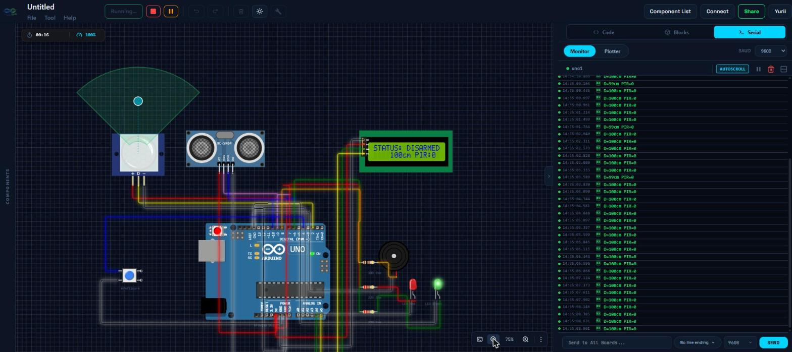
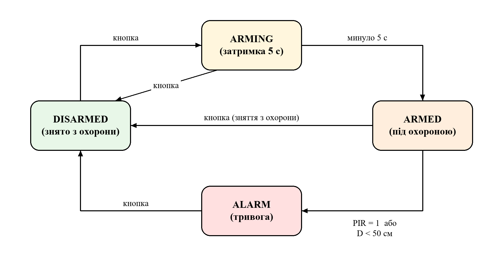
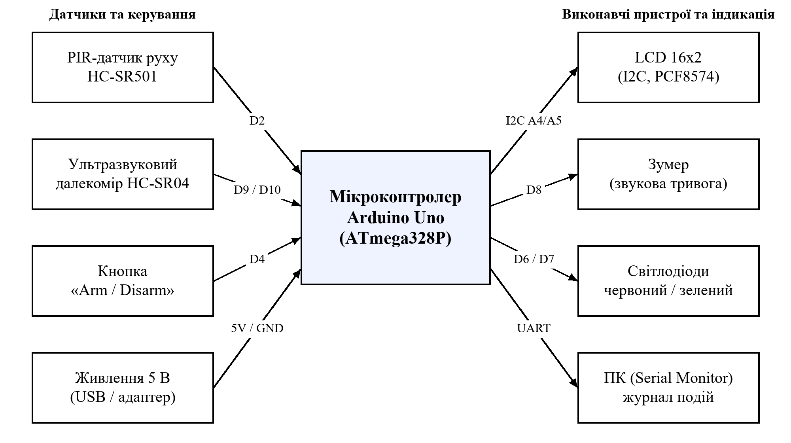
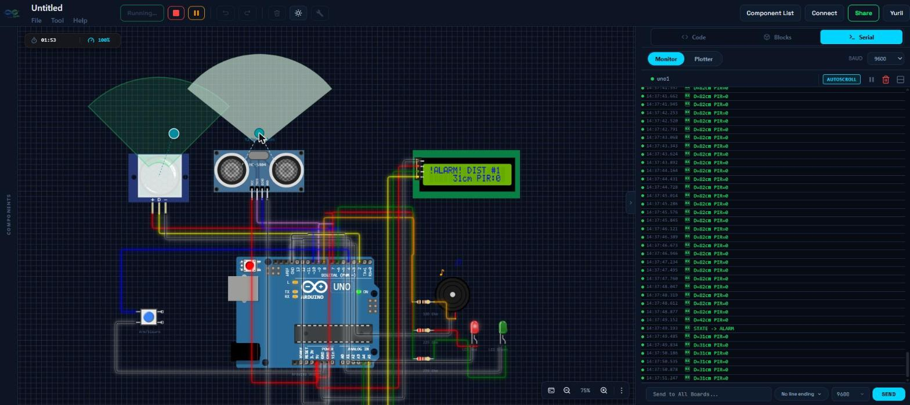

# Охоронний пристрій на Arduino (HC-SR501 + HC-SR04 + LCD)

Курсова робота з дисципліни «Програмно-апаратні засоби Internet-речей».

**Тема:** Виготовлення охоронного пристрою на платі Arduino з використанням датчиків HC-SR501 і HC-SR04 та виводом інформації на LCD дисплей.

**Виконав:** Петрушин Юрій, група МТк-310, ВСП «Фаховий коледж інформаційних технологій НУ «Львівська політехніка»», 2026.

**Інтерактивна модель у симуляторі OpenHW Studio:**
https://openhw-studio.fossee.in/simulator/share/cf4311d275211c5daee2f5ac



## Можливості

- виявлення руху PIR-датчиком HC-SR501;
- вимірювання відстані ультразвуковим далекоміром HC-SR04 (2–400 см), тривога при наближенні ближче 50 см;
- постановка на охорону / зняття з охорони кнопкою, затримка на вихід 5 с;
- двотонова сирена (15 с) і світлова індикація тривоги;
- виведення режиму, відстані та стану PIR на LCD 16x2 (I2C);
- журнал подій у Serial Monitor (9600 бод).

## Режими роботи



| Режим | LCD (рядок 1) | Світлодіоди | Звук |
|---|---|---|---|
| Знято з охорони | `STATUS: DISARMED` | зелений | – |
| Постановка | `ARMING IN N s` | червоний блимає | короткий сигнал щосекунди |
| Під охороною | `STATUS: ARMED` | червоний | – |
| Тривога | `!ALARM! PIR/DIST #N` | червоний блимає | сирена 15 с |

## Компоненти (BOM)

| № | Компонент | К-сть | Примітка |
|---|---|---|---|
| 1 | Arduino Uno R3 | 1 | ATmega328P, 16 МГц |
| 2 | Датчик руху HC-SR501 | 1 | PIR, до 7 м, 120° |
| 3 | Далекомір HC-SR04 | 1 | 40 кГц, 2–400 см |
| 4 | LCD 1602 + адаптер PCF8574 | 1 | I2C, адреса 0x27 |
| 5 | Зумер пасивний | 1 | через резистор 100 Ом |
| 6 | Світлодіоди червоний / зелений | 2 | через резистори 220 Ом |
| 7 | Кнопка тактова | 1 | Arm / Disarm |
| 8 | Резистори 220 Ом ×2, 100 Ом ×1 | 3 | |
| 9 | Макетна плата, проводи Dupont | – | |

## Підключення



| Компонент | Вивід | Пін Arduino |
|---|---|---|
| HC-SR501 | VCC / OUT / GND | 5V / D2 / GND |
| HC-SR04 | VCC / TRIG / ECHO / GND | 5V / D9 / D10 / GND |
| LCD 1602 I2C | VCC / GND / SDA / SCL | 5V / GND / A4 / A5 |
| Зумер | SIG / GND | D8 (через 100 Ом) / GND |
| Світлодіод червоний | анод / катод | D7 (через 220 Ом) / GND |
| Світлодіод зелений | анод / катод | D6 (через 220 Ом) / GND |
| Кнопка | вивід 1 / вивід 2 | D4 (INPUT_PULLUP) / GND |

## Структура репозиторію

```
security/security.ino   – прошивка для Arduino
diagram.json            – схема для імпорту в OpenHW Studio (File → Import)
images/                 – схеми, діаграми та скріншоти тестування
```

## Збирання та завантаження

1. Встановіть Arduino IDE 2.x.
2. Через *Library Manager* встановіть бібліотеку **LiquidCrystal I2C** (Frank de Brabander) версії 1.1.2.
3. Відкрийте `security/security.ino`, оберіть плату **Arduino Uno** і завантажте прошивку.
4. Якщо дисплей нічого не показує, змініть `LCD_ADDR` на `0x3F` або підстройте контрастність потенціометром на адаптері.

Параметри (поріг відстані, затримка на вихід, тривалість сирени) задаються константами на початку файлу:

```cpp
#define DIST_THRESHOLD_CM 50     // поріг спрацювання далекоміра, см
#define EXIT_DELAY_MS     5000   // затримка на вихід, мс
#define ALARM_TIME_MS     15000  // тривалість сирени, мс
```

## Результати тестування

Похибка вимірювання відстані в діапазоні 2–350 см не перевищує 1 см, час реакції на подію – не більше 200 мс. Прошивка займає 8748 байт (27 %) Flash і 610 байт (29 %) SRAM.




## Ліцензія

Код поширюється під ліцензією [MIT](LICENSE).
